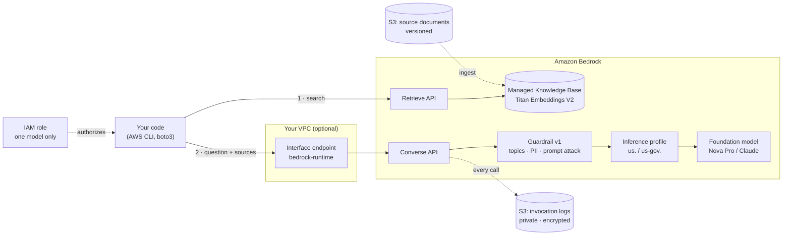
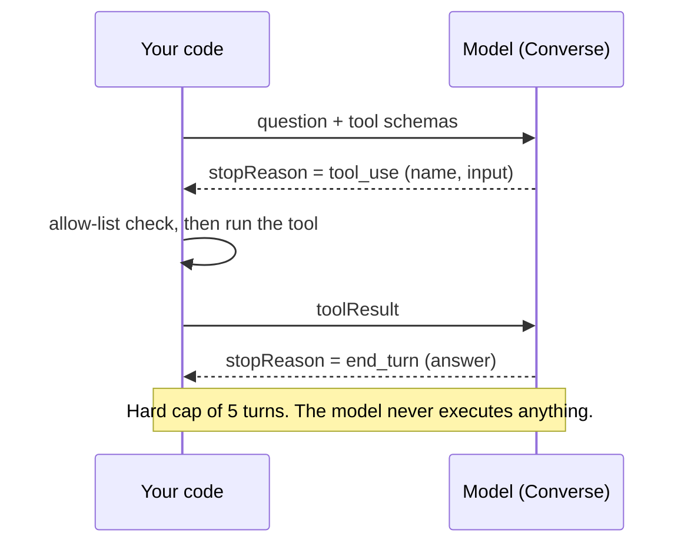

<div align="center">

# Amazon Bedrock, GovCloud-Ready

**A hands-on lab that builds a secure Amazon Bedrock stack in AWS commercial, written so every step carries over to AWS GovCloud (US) at IL5.**

[](https://github.com/ekaumoh/bedrock-govcloud-lab/actions/workflows/ci.yml)
[](LICENSE)


[Architecture](#architecture) · [Quick start](#quick-start) · [Modules](#lab-modules) · [Sample output](#verified-results) · [GovCloud](#moving-to-govcloud) · [Troubleshooting](#troubleshooting)

</div>

---

## Why this exists

Most Bedrock tutorials stop at "call a model." Regulated workloads need the parts around the call: least-privilege access, a private network path, an audit trail, content filtering, grounded answers with citations, and a clean teardown.

This repo builds all of those in about three hours. Every script and Terraform file derives the AWS partition (`aws` or `aws-us-gov`) at run time, so nothing needs rewriting to move to GovCloud.

> [!IMPORTANT]
> This is a learning lab. Run it in commercial with **non-sensitive test data only**. Never put CUI (Controlled Unclassified Information) in a commercial account.

## What you build

| | Capability | What it proves |
|---|---|---|
| 🔐 | **Least-privilege IAM** | A role can call exactly one model. A second model returns `AccessDeniedException`. |
| 🌐 | **Private network path** | An interface VPC endpoint keeps model traffic off the internet. |
| 📜 | **Invocation logging** | Every prompt and response lands in a private, encrypted S3 bucket. |
| 🛡️ | **Guardrails** | Denied topics, PII masking, and prompt-attack blocking, versioned and tested four ways. |
| 📚 | **RAG with citations** | Answers come only from your documents, cite the source file, and say "not found" when they should. |
| 🧰 | **Tool use** | The model *asks* to call a tool; your code checks an allow-list and runs it. |
| 🏗️ | **Infrastructure as code** | The guardrail, invoke policy, and logging stack in partition-aware Terraform. |
| 🧹 | **Verified teardown** | One command removes everything; a second proves zero resources remain. |

## Architecture



**Request path.** Your code retrieves matching chunks from the Knowledge Base, then sends the question plus those chunks to `Converse`. The guardrail screens the input, the inference profile routes to the model, and the guardrail screens the output. Bedrock writes the full exchange to the log bucket.

<details>
<summary><b>Tool-use loop</b></summary>



</details>

## Quick start

**Prerequisites:** AWS CLI v2, Python 3.10+, Terraform 1.6+, an AWS account with Bedrock model access, and IAM Identity Center (SSO) credentials.

```bash
git clone https://github.com/ekaumoh/bedrock-govcloud-lab.git && cd bedrock-govcloud-lab
```
(Downloads the repo.)

```bash
cp .env.example .env && ${EDITOR:-nano} .env
```
(Creates your local settings file. Set `AWS_PROFILE`. `.env` is git-ignored.)

```bash
source .env && aws sso login && make venv preflight smoke
```
(Loads settings, signs in, installs boto3 into `.venv`, proves your partition and Region, then makes a 5-token call to prove the model is reachable.)

Run `make help` to list every target.

## Lab modules

Run in order. Each module is one command and prints `PASS` or `FAIL` for what it proves.

| # | Time | Command | Proves | Bills while idle? |
|---|---|---|---|---|
| 0 | 5 min | `make preflight` | Partition (`aws` vs `aws-us-gov`), Region, identity, model | No |
| 1 | 15 min | `make smoke` · `make first-call` | Model is callable; Converse and streaming work | No |
| 2 | 15 min | `make vpce-up` · `make vpce-down` | Private network path for `bedrock-runtime` | **Yes, about $0.02/hr** |
| 3 | 10 min | `make iam` | One model allowed, another denied | No |
| 4 | 10 min | `make logging` | Prompts and responses land in a private S3 bucket | No (storage only) |
| 5 | 20 min | `make guardrail` | Topic block, PII masking, prompt-attack block, no false positive | No |
| 6 | 40 min | `make kb-upload` → console → `make kb-sync KB_ID=…` · `make kb-canary` · `make rag Q="…"` | Every document indexed; cited answers; honest "not found" | Storage only |
| 7 | 20 min | `make tools` | Tool-use loop with allow-list and turn cap | No |
| 8 | 20 min | `make tf-init tf-plan tf-apply` · `make tf-destroy` | Guardrail, invoke policy, and logging as code | No |
| 9 | 10 min | `make cleanup` · `make verify` | Zero lab resources remain | — |

> [!TIP]
> Module 6 creates the Knowledge Base in the console, because the console now defaults to a **Managed Knowledge Base** whose data-source API differs from the classic S3 shape. Point the data source at the **bucket root**, not a single file.

## Verified results

Results observed while building this lab on Amazon Nova Pro. Guardrail lines are shown in the format the scripts print; account details are removed.

<details open>
<summary><b>Guardrail and RAG</b></summary>

```text
==> Tests
  PASS input: denied topic + PII blocked
  PASS output: PII anonymized -> Contact the help desk at {EMAIL} or {PHONE}.
  PASS prompt attack blocked before the model
  PASS normal question passes (max_tokens)

$ make rag Q="How often do TLS certificates rotate, and how much notice does the change ticket need?"
ANSWER:  TLS certificates rotate every 60 days, and the change ticket must be approved 72 hours before the rotation [1].
SOURCES: [1] tls-rotation.md, [2] incident-escalation.md

$ make rag Q="What is our database backup retention period?"
ANSWER:  Not found in the provided sources.
```

</details>

<details>
<summary><b>Tool use</b></summary>

```text
--- turn 1: stopReason=tool_use
MODEL REQUESTED: get_cluster_status {"cluster": "lab-cluster-1"}
APP RETURNED:    {"cluster": "lab-cluster-1", "nodes_ready": 5, "nodes_total": 6, "pending_pods": 3}
--- turn 2: stopReason=end_turn
ANSWER: The cluster lab-cluster-1 is not fully healthy. There is 1 node that is not ready
out of a total of 6 nodes, and there are 3 pending pods.
```

</details>

<details>
<summary><b>Terraform and teardown</b></summary>

```text
Apply complete! Resources: 2 added, 0 changed, 0 destroyed.
partition   = "aws"
profile_arn = "arn:aws:bedrock:us-east-1:<ACCOUNT_ID>:inference-profile/us.amazon.nova-pro-v1:0"

$ aws bedrock-runtime apply-guardrail ... --content '[{"text":{"text":"My SSN is 123-45-6789"}}]'
GUARDRAIL_INTERVENED

KBs: 0  Guardrails: 0  Endpoints: 0  Logging: None
Buckets: none
```

</details>

## Repository layout

```text
.
├── scripts/
│   ├── lib/common.sh            # partition detection, state store, output helpers
│   ├── 00-preflight.sh          # identity, partition, Region, model
│   ├── 01-smoke-test.sh         # 5-token call per model + Anthropic use-case check
│   ├── 02-vpce-up.sh            # interface endpoint(s), optional model allow-list policy
│   ├── 03-vpce-down.sh
│   ├── 04-iam-least-privilege.sh
│   ├── 05-logging-up.sh         # private, encrypted log bucket + account logging config
│   ├── 06-guardrail-up.sh       # create, version, test four ways
│   ├── 07-kb.sh                 # upload | sync | canary
│   ├── 90-cleanup.sh            # dependency-ordered teardown
│   └── 91-verify-clean.sh       # non-zero exit if anything remains
├── src/
│   ├── first_call.py            # Converse + streaming
│   ├── rag.py                   # retrieve-then-generate with citations
│   ├── tool_use.py              # allow-listed tool loop
│   └── labutil.py
├── terraform/                   # guardrail, invoke policy, logging stack
├── policies/guardrail.json
├── sample-docs/                 # test runbooks with facts no model could know
├── docs/
│   ├── govcloud.md              # 20 do-not-forgets for GovCloud / IL5
│   └── lessons-learned.md       # every failure hit while building this, and the fix
└── .github/workflows/ci.yml     # shellcheck, ruff, terraform validate, secret scan
```

## Design decisions

| Decision | Why |
|---|---|
| **Partition derived at run time** | `arn:aws:` hand-typed into a policy silently matches nothing in GovCloud. Scripts read the partition from `sts get-caller-identity`; Terraform uses `data "aws_partition"`. |
| **Retrieve-then-generate, not `RetrieveAndGenerate`** | Managed Knowledge Bases do not support `RetrieveAndGenerate`. Doing both steps yourself also lets you attach a guardrail, pin `temperature: 0`, and log exactly which sources fed each answer. It works with every KB type. |
| **`bedrock-runtime`, not `bedrock-mantle`** | Guardrails and invocation logging work only through `bedrock-runtime`. Audited workloads need both. |
| **Smoke test over status APIs** | `get-foundation-model-availability` can report `AVAILABLE` / `AUTHORIZED` while invoke still fails. Only a real call proves access. |
| **Guardrail versions pinned** | Code references `1`, never `DRAFT`. A policy change is a new version; rollback is changing one value. |
| **Nova Pro as the default model** | No extra use-case form, so the lab runs on a new account. Swap `BEDROCK_MODEL` to Claude when access is granted; nothing else changes. |
| **Scripts and Terraform both** | Scripts teach each API call and print evidence. Terraform shows the production shape: reviewed, repeatable, destroyable. |

## Cost

All prices are US commercial on-demand and approximate. See [Bedrock pricing](https://aws.amazon.com/bedrock/pricing/) and [PrivateLink pricing](https://aws.amazon.com/privatelink/pricing/).

| Resource | Charged | Full lab run |
|---|---|---|
| Model calls | Per input/output token | Cents |
| Guardrail checks | Per text unit checked | Cents |
| Interface VPC endpoint | **Per hour per AZ** + per GB | About $0.02/hr; delete when paused |
| Managed Knowledge Base | Per GB indexed per month + per retrieval | Fractions of a cent for the sample docs |
| S3 (logs, documents) | Per GB stored | Fractions of a cent |

> [!WARNING]
> The VPC endpoint is the only hourly charge. Run `make vpce-down` whenever you pause. If you build a customer-managed KB instead, avoid OpenSearch Serverless for labs: it can carry an hourly minimum.

## Security

- **No long-term keys.** IAM Identity Center (SSO) only; the IAM test uses short-lived `sts assume-role` credentials in a subshell.
- **Least privilege by ARN.** The invoke policy lists one inference profile and one base model, never `bedrock:*`.
- **Logs are as sensitive as the data.** The log bucket blocks public access, denies non-TLS requests, and accepts writes only from Bedrock for this account. Set `KMS_KEY_ARN` / `kms_key_arn` to use a customer-managed key.
- **Nothing sensitive in Git.** `.env`, Terraform state, and downloaded logs are git-ignored. CI runs gitleaks and fails on any ARN containing a real account ID.
- **Tools are allow-listed.** The model's tool request is never the authorization.

See [SECURITY.md](SECURITY.md) to report an issue.

## Moving to GovCloud

The code is the same. The inputs change.

| Item | Commercial | GovCloud (US) |
|---|---|---|
| Region | `us-east-1` | `us-gov-west-1` or `us-gov-east-1` |
| ARN partition | `arn:aws:` | `arn:aws-us-gov:` (derived automatically) |
| Profile prefix | `us.` / `global.` | `us-gov.` only |
| Model access | In-account | EULA and Anthropic form in the **linked standard account**, then enable in GovCloud |
| Default VPC | Usually present | Usually absent; set `VPC_ID` |
| `bedrock-mantle` | Select Regions | `us-gov-west-1` only; no Guardrails or invocation logging |
| Encryption | AWS-owned keys acceptable for a lab | Customer-managed KMS keys for every copy of CUI |

> [!CAUTION]
> **Available is not authorized.** As of October 2026, Claude Sonnet 5 holds FedRAMP High (Class D) and DoD IL4/IL5 on Bedrock in GovCloud; Claude Sonnet 5.5 and Opus 5.5 hold FedRAMP Class D only. Check the [model authorization page](https://aws.amazon.com/compliance/services-in-scope/FedRAMP/amazon-bedrock-models/) before every design review.

Full checklist: **[docs/govcloud.md](docs/govcloud.md)**.

## Troubleshooting

Every one of these happened while building this lab. Details in [docs/lessons-learned.md](docs/lessons-learned.md).

| Symptom | Cause | Fix |
|---|---|---|
| `AccessDeniedException ... is not available for this account` on Claude, Nova works | Anthropic use-case form not filed, or account not yet eligible | `aws bedrock get-use-case-for-model-access`; file the form in the console playground |
| Same error for one Claude model only | Agreements are per model | Accept that model's agreement too |
| `Invalid length for parameter modelId, value: 0` | `BEDROCK_MODEL` empty in a new terminal | `source .env` |
| `No default VPC` | Default VPC deleted (common hardening) | Set `VPC_ID`, or `aws ec2 create-default-vpc` for a lab |
| Every KB question returns the same file with identical scores | Only one document indexed (data source scoped to one file, or never synced) | `make kb-sync`; point the data source at the bucket root |
| `COMPLETE 0 0` after a sync | Nothing changed since the last sync (correct) | Check `scanned`, not `new` |
| `Unsupported data source type for MANAGED knowledgebase type` | Classic S3 data-source shape sent to a Managed KB | Add data sources in the console, or use the managed shape |
| `This operation is not supported for managed knowledge bases` | `RetrieveAndGenerate` on a Managed KB | Use `src/rag.py` (retrieve-then-generate) |
| `vectorSearchConfiguration is not supported for managed knowledge bases` | Classic retrieval config | Omit `retrievalConfiguration`, or use `managedSearchConfiguration` |
| `<thinking>...</thinking>` in answers | Model reasoning emitted during tool use | `labutil.strip_thinking()` |
| CLI output stops at `:` | AWS CLI pager | `export AWS_PAGER=""` |

## References

- [Amazon Bedrock in AWS GovCloud (US)](https://docs.aws.amazon.com/govcloud-us/latest/UserGuide/govcloud-bedrock.html)
- [Regional availability by models, including GovCloud model enablement](https://docs.aws.amazon.com/bedrock/latest/userguide/models-region-compatibility.html)
- [Converse API](https://docs.aws.amazon.com/bedrock/latest/userguide/conversation-inference.html) · [Tool use](https://docs.aws.amazon.com/bedrock/latest/userguide/tool-use.html)
- [Guardrails](https://docs.aws.amazon.com/bedrock/latest/userguide/guardrails.html) · [ApplyGuardrail](https://docs.aws.amazon.com/bedrock/latest/userguide/guardrails-use-independent-api.html)
- [Knowledge Bases](https://docs.aws.amazon.com/bedrock/latest/userguide/knowledge-base.html) · [Managed Knowledge Base launch](https://aws.amazon.com/blogs/aws/introducing-amazon-bedrock-managed-knowledge-base-for-faster-more-accurate-enterprise-ai-applications/) · [Retrieve API](https://docs.aws.amazon.com/bedrock/latest/APIReference/API_agent-runtime_Retrieve.html)
- [Model invocation logging](https://docs.aws.amazon.com/bedrock/latest/userguide/model-invocation-logging.html)
- [Interface VPC endpoints for Bedrock](https://docs.aws.amazon.com/bedrock/latest/userguide/vpc-interface-endpoints.html)
- [Identity-based policy examples](https://docs.aws.amazon.com/bedrock/latest/userguide/security_iam_id-based-policy-examples.html)
- [Troubleshooting API error codes](https://docs.aws.amazon.com/bedrock/latest/userguide/troubleshooting-api-error-codes.html)
- [Bedrock quotas](https://docs.aws.amazon.com/bedrock/latest/userguide/quotas.html)
- [Terraform `aws_bedrock_guardrail`](https://registry.terraform.io/providers/hashicorp/aws/latest/docs/resources/bedrock_guardrail)

## License

[MIT](LICENSE). Personal learning project; not affiliated with or endorsed by Amazon Web Services or any employer.
